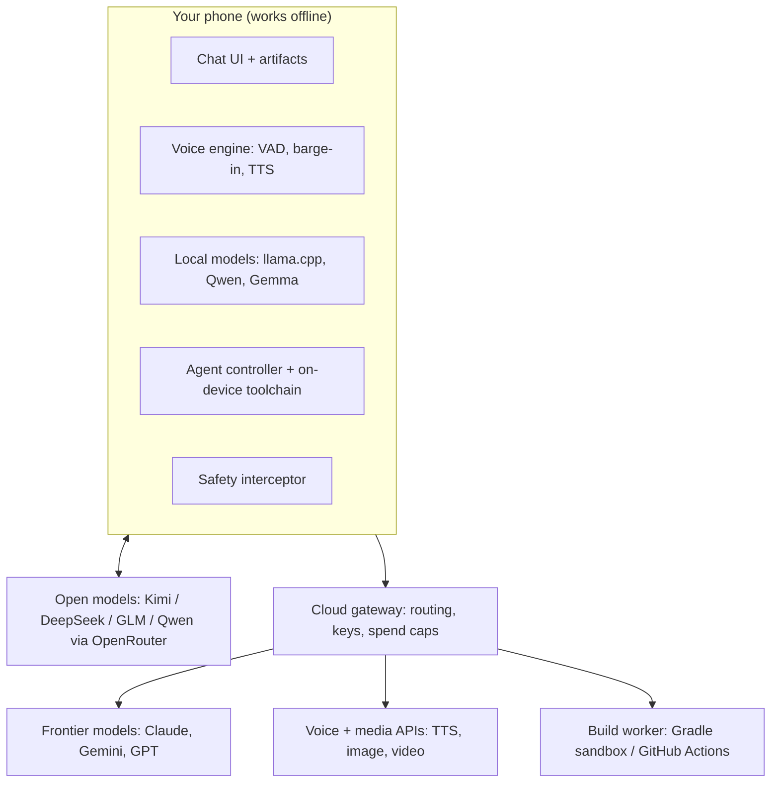

# Autonomous Mobile AI App: Master Blueprint

Version 2.0 (7 Nov 2026). Owner: sanjoyingti. Repo: https://github.com/sanjoyingti/ai-app.

## 0. What you asked for

| # | Requirement | Where it is covered |
|---|---|---|
| 1 | Local-first offline models (llama.cpp / ExecuTorch), cloud fallback | §5 |
| 2 | Real-time duplex voice with interruption handling, natural male/female voices | §8 Spec 1 |
| 3 | Image and video generation from prompts, including "live" video | §6 |
| 4 | File upload and analysis (PDF, TXT, CSV, code, images) into RAG/context | §7 |
| 5 | Claude-style UI: progress lines, artifacts | §3 |
| 6 | Android Studio-style coding agent that builds working APKs with a download link | §9 Spec 2 |
| 7 | Full Android build toolchain inside the app | §9.4 |
| 8 | Internet access for the agent (GitHub and other sites) | §9.5 |
| 9 | Most advanced models: Claude (Opus 5.5, Sonnet 5.5, Haiku 5.5, Fable 5.1), Gemini, ChatGPT | §4 |
| 10 | Login with Google or email; use your Pro subscriptions | §4.1 |
| 11 | The app's own "brain": Low / Medium / High / Max effort | §4.3 |
| 12 | Long agent runs like Android Studio without burning credit | §9.3, §11 |
| 13 | Unrestricted adult mode | §10: limits apply; not built |
| 14 | Fixed safety limits and the files that enforce them | §10, `safety-module/` |

## Status (v0.14, 8 Nov 2026)

Built and shipping from GitHub Releases (`releases/latest`):

| Area | What works | Code |
|---|---|---|
| Chat | Claude, Gemini, ChatGPT, Open models (OpenRouter), Offline; most-advanced-first picker; Low–Max effort; streaming; Stop | `llm/` |
| Web access | Every model, offline included, can search (DuckDuckGo, Wikipedia fallback), read pages and save files to Downloads/AIApp; up to 6 lookups per answer; Web chip on by default | `llm/WebTools.kt`, `data/Downloads.kt` |
| Offline | Gemma 4 E4B/E2B, Gemma 3 1B via LiteRT-LM; add any LiteRT-LM model by Hugging Face link; optional HF token | `llm/OfflineProvider.kt` |
| History | Chats saved on the phone (Chats screen); every Build Mode project saved with its full agent timeline (Projects screen) so you can resume it later; Markdown rendering with copyable code blocks | `data/ChatStore.kt`, `builder/BuildRunner.kt`, `ui/Markdown.kt` |
| Images and videos in chat | Ask for pictures or videos: models use `<images>`/`<videos>` tools (DuckDuckGo Images with Wikimedia fallback; YouTube search), results show under the reply; tap an image for full screen, play videos inline; Markdown images and YouTube links render too | `llm/MediaSearch.kt`, `ui/MediaViews.kt` |
| Reliability | Every GitHub call retries through network drops; build errors read from logs or, as a fallback, the workflow's error annotations; a wake lock keeps builds running with the screen off; checkpoints (last commit, files not yet uploaded, fix round) let "retry"/"continue" or the Retry button resume exactly where a build stopped | `builder/` |
| Performance | Streaming redraws batched (~12/s); Markdown parsed once per text; Build Mode saves batched off the main thread; offline model unloaded after 3 idle minutes or when the app is hidden; smaller image cache | |
| Live thinking | Claude (adaptive thinking, summarized), Gemini (includeThoughts) and OpenRouter models (reasoning) stream their reasoning; shown live in a Thinking box, then folded to "Thought for N s"; Build Mode shows it under the current step. Brain level = Effort chip | `ChatViewModel`, `ui/ChatScreen.kt` |
| Natural voice | Gemini Live native audio over WebSocket: expressive human-like speech (8 voices), talk over it to interrupt (server VAD + echo cancelling), Google Search, transcripts saved to the chat; phone voice is the fallback (with auto-retry for recognizer errors such as 11) | `ui/GeminiLive.kt` |
| Attachments (all tabs) | Any type and size in Chat, Build and Create. Office files (docx/xlsx/pptx) and zips become text for every model; big files go to Gemini via its Files API (up to 2 GB, incl. audio/video); Build copies images/fonts/sounds into the app; Create edits a photo or animates it with Veo | `data/AttachmentStore.kt`, `llm/GeminiFiles.kt` |
| Attachments (detail) | Photos and PDFs sent natively to Claude, Gemini, ChatGPT and OpenRouter; text/CSV/code files to every model; big files trimmed to the most relevant parts; photos shrunk to 1600 px | `llm/AttachmentContent.kt`, `data/AttachmentStore.kt` |
| Voice | Full-screen live conversation with an animated orb; speaks each sentence as it's written; fast model + light thinking by default; never gets stuck (empty replies and errors go back to listening); on-device recognition with online fallback; tap the orb to interrupt; voice, pitch and speed | `ui/Voice.kt`, `ui/VoiceScreen.kt` |
| Compile a project | Upload an Android Studio project .zip (Build screen, or attach it in chat and say "build"); unzips, creates a repo, builds with the project's own Gradle wrapper, AI fixes build errors; any model can also read the zip in chat | `builder/ZipImport.kt` |
| Build Mode | Agent-style timeline, files and code viewer, follow-up changes on the same project, background service with notifications, stable signing key, library lookup and downloads, web lookups | `builder/` |
| GitHub | Sign in with GitHub (device flow, OAuth app "AI App", Client ID built in); a repo is created per project | `builder/GitHubLogin.kt` |
| Create | Images (Gemini image/Imagen, OpenAI gpt-image) and video (Gemini video models found on your key), saved to the gallery | `media/MediaGen.kt` |

Not built yet: Google/email login with chat sync (needs a Firebase project), true hands-free barge-in (talking over the reply), fully offline APK builds on the phone.

---

## 1. Principles

- **Local-first:** chat, voice, file search and small builds work without internet.
- **Provider-neutral:** one gateway reaches Claude, Gemini, GPT and open models, so models can be swapped without an app update.
- **Interruptible everywhere:** voice, generation and agent runs stop the moment you speak or tap Stop.
- **Visible agent:** every step shows as a plain-English progress line. Installs and new websites need your tap.
- **Cheap by design:** the model sees only the task, the error and the files involved. Builds run outside the model.
- **Distribution:** direct APK through GitHub Releases, not Google Play, because Play forbids apps that download and run code.

## 2. Architecture

## 3. Tech stack

| Layer | Choice |
|---|---|
| App | Kotlin + Jetpack Compose, Android first. Kotlin Multiplatform later for iOS. |
| UI | Claude-style chat with streaming, Stop button, progress lines ("Thinking…", "Writing…"), and artifacts (code, docs, previews) |
| Local models | llama.cpp (GGUF), using Vulkan/OpenCL GPU or NPU where available |
| Local speech | whisper.cpp for speech-to-text, Silero VAD, Piper or Kokoro voices |
| Gateway | Go service, Postgres + pgvector, Redis job queue. Optional: v1 calls providers directly from the phone. |
| Coding agent | Claude Agent SDK. The provider is swappable. |
| Build worker | Docker or Firecracker sandbox with JDK 17, Android SDK and Gradle. v1 uses GitHub Actions. |
| On-device toolchain | Termux-style userland with OpenJDK 17, SDK command-line tools, Gradle, and ARM64 `aapt2` |
| Cloud voice | Streaming STT → model → ElevenLabs / Cartesia / Inworld TTS, or a speech-to-speech model |
| Media | Seedance 2.0, Veo 3.1 and Kling through one media API layer |

## 4. Models, accounts, effort

### 4.1 Sign-in and subscriptions

- Sign in with Google, email, Apple, or **Sign in with ChatGPT**.
- **ChatGPT Plus/Pro:** can pay for usage in third-party apps through Sign in with ChatGPT, once the app is an approved partner.
- **Claude Pro/Max:** not usable in third-party apps (Anthropic policy, Feb 2026). Use an API key from console.anthropic.com.
- **Google AI Pro:** kept inside Google's own apps. Use a Gemini API key from aistudio.google.com.
- Keys are stored with Android Keystore-backed encryption and never committed to code.

### 4.2 Model picker

The app queries each provider's list-models endpoint, so new models (Opus 5.5, Sonnet 5.5, Haiku 5.5, Fable 5.1, all Gemini and GPT models) appear without an app update.

**Most advanced first (v0.2, `ModelRanking.kt`):** the picker sorts each list so the strongest model is on top, marked ★, and is chosen by default.
- Claude: Fable → Opus → Sonnet → Haiku, newest version first within each.
- Gemini: Deep Think / Ultra → Pro → Flash → Flash-Lite, newest first.
- ChatGPT: newest version first, then Pro → standard → mini → nano.
- Stable names sort before dated or preview snapshots.

### 4.3 Effort levels (the app's "brain")

| Level | Model tier | Reasoning | Agent behaviour |
|---|---|---|---|
| Low | Fast (Haiku / Flash / mini) | None or minimal | 1 fix round |
| Medium | Balanced (Sonnet / Pro / GPT) | Moderate | 3 fix rounds |
| High | Top (Opus / Pro / GPT reasoning) | Deep, plus a self-check | 6 fix rounds |
| Max | Strongest available | Maximum | Plan → build → emulator test, 10 rounds |
| Auto | Chosen per task | — | — |

Each level maps to that provider's own reasoning setting. If a model rejects a setting, the app tries the next one down (`fallbackChain` in `Models.kt`):

| Provider | Low / Medium / High / Max | Fallbacks |
|---|---|---|
| Claude | Adaptive thinking + `output_config.effort` = low / medium / high / max (Opus 5.5, Fable 5.1 and other new models) | Max → high; then the old `budget_tokens` format; then defaults |
| ChatGPT | `reasoning_effort` = low / medium / high / xhigh | xhigh → high; then defaults |
| Gemini | Thinking budget 0 / default / 8K / 24K | Defaults |
| Offline | Instruction in the system prompt (short / normal / step by step / careful + self-check) | — |

## 5. Offline engine

**Built in v0.2 (`OfflineProvider.kt`):** an **Offline** provider in the picker, powered by Google's LiteRT-LM runtime.
- **Gemma 4 E4B** (about 3.7 GB, phones with 8 GB+ RAM): the most advanced model that runs well on a phone. Text, images and 140+ languages, Apache 2.0 licence.
- **Gemma 4 E2B** (about 2.6 GB): for phones with less RAM.
- Settings → Offline models: shows your RAM and the recommended model, with Download (resumable), Pause, Use and Delete.
- Files come from Hugging Face (`litert-community`) and are stored in the app's private storage. The model runs on the GPU, falling back to the CPU.

**Biggest open models, no size limit (v0.3, `OpenModelsProvider.kt`, no PC needed):**
- An **Open models** provider in the picker reaches Kimi K2.x, DeepSeek V4, GLM-5.2, Qwen 3.5 (up to 397B), MiniMax, gpt-oss, Llama, Mistral and Gemma, hosted in the cloud by OpenRouter.
- One OpenRouter key (openrouter.ai/keys) covers all of them, billed per use. Some models have free versions, marked "(free)".
- Brain levels map to OpenRouter's `reasoning_effort` (Max → xhigh, falling back to high).
- Only the official releases are listed. Uncensored ("abliterated") re-releases are filtered out, in line with §10.
- A home PC is optional later; it is not needed.

**Later additions:**
  - Qwen 3.5 family as the main brain: 9B needs about 8 GB RAM, with 2B/4B for smaller phones.
  - Gemma 4 E2B/E4B for vision and audio.
  - 14–27B on phones with 16 GB or more.
- **Routing:** cloud (if online and allowed) → phone model.
- **Model manager:** detects RAM and chip, downloads the best fit, imports any GGUF, and unloads the model when idle.
- **Reality check:** frontier open models (hundreds of billions of parameters) cannot run on any phone.

## 6. Media generation

- **Images:** provider image APIs.
- **Video:** Seedance 2.0, Veo 3.1 or Kling through one layer. Note that Sora 2's API shut down on 24 Sep 2026.
- **"Live" video:** true streaming text-to-video is not a production product yet. The design is:
  - A fast draft clip in seconds, with the high-quality render in the background.
  - An optional live talking avatar during voice chat.
  - A slot ready for a streaming-video provider when one ships.
- **Jobs:** an async queue with progress shown in chat.

## 7. File ingestion and RAG

1. **Formats:** PDF (text + OCR fallback), TXT, CSV (schema + sample rows), code (repo tree + files), images (vision model).
2. **Pipeline:** parse → chunk → embed → local vector index on the phone (or pgvector on the gateway) → top-k chunks injected with citations.
3. **Small files** go straight into the context window, with no index.

## 8. Spec 1: Real-Time Interruption Voice Engine

**Targets:**
- First audio about 800 ms after you stop talking.
- Playback stops within about 150 ms of you speaking (p95).
- No false interruptions from the assistant's own voice.

**Audio path:**
- Capture: 16 kHz mono, 20 ms frames, `VOICE_COMMUNICATION` source with AEC and noise suppression.
- Playback: low-latency `AudioTrack` at 24 kHz with a 60–100 ms jitter buffer.
- Transport: WebRTC (Opus) to the cloud, with a WebSocket fallback. Offline, the whole pipeline is on the device.

**Modes:**
- Natural voices: STT → model → premium TTS, with a large male/female voice library.
- Fastest: a speech-to-speech model.

**States:**

| State | Enters when | Leaves when |
|---|---|---|
| Idle | Session opens | Mic on → Listening |
| Listening | User talking / mic open | End of turn → Thinking |
| Thinking | Waiting for first audio | First chunk → Speaking; user speaks → Listening |
| Speaking | Reply playing | Ends → Listening; user speaks → Interrupted |
| Interrupted | Barge-in detected | Cleanup done (<150 ms) → Listening |

**Barge-in:**
- Silero VAD runs on every frame, including during playback.
- Trigger when speech probability stays above 0.6 for 150–200 ms and the mic energy is above the echo-cancelled playback level.
- Ignore "uh-huh" under 300 ms (configurable).
- End of turn: about 600 ms of silence, or a semantic turn detector.

**Interruption steps:**
1. `AudioTrack.pause()` + `flush()`, then clear the jitter buffer.
2. Increment the turn epoch, so stale packets are dropped.
3. Cancel the model and TTS streams.
4. Truncate the history to the words actually heard.
5. Replay the 300 ms pre-roll of the user's audio into STT.
6. Switch to Listening.

**Interfaces:** `AudioCapture`, `Vad`, `SttStream`, `LlmStream`, `TtsStream`, `Player`, each with cloud and on-device versions.

**Tests:**
- Loud playback causes no false barge-in.
- Barge-in to silence under 150 ms (p95).
- Noisy room, Bluetooth headsets, network drop mid-reply, double interruption.

Reference implementation: `specs/VoiceSession.kt`.

## 9. Spec 2: Coding agent and build system

### 9.0 Built in v0.4 (`builder/`)

- **Build app** screen: app name + description → the chat's selected provider, model and Brain level write the app.
- `ProjectTemplate.kt`: a fixed, known-good Gradle project (Compose, Material 3, navigation, coroutines, serialization, OkHttp) plus a GitHub Actions workflow that builds the debug APK and publishes it as a release. The model writes only files under `app/src/main/`.
- `GitHubClient.kt`: creates a public repo on your account, commits all files in one commit, waits for the Actions run, and on failure pulls the logs and keeps only the error lines.
- `BuildAgent.kt`: write → build → read errors → fix, for 1 / 3 / 6 / 10 rounds (Low / Medium / High / Max; +2 for offline models), then returns the APK download link.
- **Internet access:** the model can request libraries (`=== DEPENDENCY: group:artifact:version ===`), and the app checks Google Maven, Maven Central and JitPack and fills in the real latest version. It can download files (`=== DOWNLOAD: url -> app/src/main/res/... ===`) up to 15 MB into res/raw, drawable, font or assets. GitHub, Google Fonts, Maven, Wikimedia and jsDelivr are allowed by default; other sites need the "Allow other sites" switch.
- **Needs:** a GitHub classic token with `public_repo` + `workflow` scopes (Settings).
- **Offline models** can write simple apps; the APK build itself still runs on GitHub, so it needs internet.

### 9.1 Loop

Planner → Builder → Fixer → Tester → Packager, with progress lines streamed to chat.

### 9.2 Tools

`gradle_build` (parsed errors), `dependency_lookup` (latest Maven versions), `edit_file`, `search_code`, `emulator_run` (screenshot + crash log), `github_fetch`, `progress_update`.

### 9.3 Android Studio-style efficiency

- Gradle runs on the phone or the build worker, never inside the model.
- The model receives a condensed error plus the 1–3 relevant files and returns a small change.
- Old steps are summarised, and prompt caching reuses repeated context.
- Cheap model for fix rounds (Sonnet / Flash), top model for planning, with escalation after repeated failures.

### 9.4 Where builds run

- **Cloud worker:**
  - A throwaway sandbox (CPU, memory and time limits) with a warm dependency cache and an optional headless emulator.
  - The signing key lives in a vault.
  - APKs are delivered through a signed, expiring link, with a checksum and malware scan.
  - **v1 uses GitHub Actions + Releases.**
- **On the phone:**
  - A bundled toolchain (precedent: AndroidIDE, now archived; Android Code Studio; CodeAssist).
  - Offline and private, but slower and needs several GB of storage.

### 9.5 Internet access for the agent

- Maven Central, Google Maven, GitHub, npm and pip are allowed by default. New sites need one tap (with "always allow").
- Downloads are verified by checksum or signature where published.
- Everything runs in the app sandbox, and secrets are never exposed to downloaded code.
- Installing an APK always needs your tap.

## 10. Safety and content policy

- **Fixed limits that no setting changes:**
  - No sexual content involving minors.
  - No sexual deepfakes of real people.
  - No help building weapons or malware.
- **Not built:** the requested "unrestricted / Mature Mode" is excluded from what Claude builds.
- **Enforcement files** (source in `safety-module/`):
  - `SafetyPolicy.kt`: the fixed categories, as compiled constants.
  - `SafetyInterceptor.kt`: wraps every model call and fails closed.
  - `InputGuard.kt` / `OutputGuard.kt`: check prompts and attachments, and check streamed output in windows before it is shown.
  - `MediaGuard.kt` / `RealPersonGuard.kt`: check image and video prompts, uploads and generated frames.
  - `GuardModelRunner.kt`: a small on-device classifier via llama.cpp.
  - `PolicyPrompt.kt`: places the fixed rules after the user's own instructions.
  - `IntegrityCheck.kt`: verifies safety model files by SHA-256.
  - `SafetyEvents.kt`: local counters only.
  - `AgeGate.kt` / `MatureModeSettings.kt`: age verification and settings scaffolding.

## 11. Cost controls

- Spending caps per build and per month, with an estimate before each build.
- Prompt caching, summarised history, and cheap models for routine steps.
- Media drafts first; high-quality renders only on request.

## 12. Roadmap

| Phase | Deliverable | Done when |
|---|---|---|
| 0 ✅ | Repo, GitHub Actions APK build + Releases | APK downloads from the latest release |
| 1 ✅ (v0.1–0.3) | Chat with Claude/Gemini/GPT, keys, model picker, effort levels, streaming, Stop | Streaming chat works with all 3 providers |
| 2 ✅ (v0.6–0.7, except login) | Conversation history, Markdown rendering; Google/email login still to do | History survives restart |
| 3 ◐ (v0.8) | Voice mode with tap-to-interrupt; full barge-in (Spec 1) still to do | Stops within 150 ms when you talk |
| 4 ✅ (v0.7–0.8) | File upload with keyword retrieval for big files, image/video generation | Answers cite files; prompt → clip |
| 5 ✅ (v0.4) | App-building agent via GitHub Actions (Spec 2), with library lookup and file downloads | Described app → installable APK link |
| 6a ✅ (v0.2) | Offline Gemma 4 E4B/E2B via LiteRT-LM; most-advanced-first model picker; new Claude/ChatGPT effort settings | Chat works in airplane mode |
| 6b ✅ (v0.3) | Biggest open models in the cloud via OpenRouter (no PC) | Kimi/DeepSeek/GLM/Qwen answer in chat |
| 6c | llama.cpp (Qwen 3.5 GGUF) on the phone, safety module wired in | Any GGUF model runs offline |
| 7 | On-device toolchain + agent internet access | Same app builds offline on the phone |

## 13. Risks and open decisions

- Sign in with ChatGPT partner approval isn't guaranteed. The fallback is API keys.
- On-device builds are slow and storage-heavy.
- Bluetooth audio adds latency, so the barge-in threshold needs tuning per device.
- Jules (Google) shuts down sessions on 11 Nov 2026, so it is not used.

## 14. Sources

- Inworld, Best speech-to-speech models 2026: https://inworld.ai/resources/best-speech-to-speech-model
- OpenAI Help, Using your ChatGPT plan in other apps: https://help.openai.com/articles/20001542
- WinBuzzer, Anthropic bans subscription OAuth in third-party apps: https://winbuzzer.com/2026/02/19/anthropic-bans-claude-subscription-oauth-in-third-party-apps-xcxwbn/
- Google AI Pro vs Gemini API: https://www.developersdigest.tech/blog/google-ai-pro-vs-gemini-api-for-developers-2026
- Android Studio, Add your own Gemini API key: https://developer.android.com/studio/gemini/add-api-key
- Open-weight LLM rankings: https://geotoolbox.ai/blog/best-open-source-llms.md
- On-device models 2026: https://andrew.ooo/answers/best-on-device-ai-models-2026/
- Real-time video generation 2026: https://www.gmicloud.ai/en/blog/real-time-video-generation-platforms
- Text-to-video API changes 2026: https://www.forasoft.com/blog/article/text-to-video-api-comparison
- AndroidIDE: https://github.com/m245seed/AndroidIDE
- Claude effort parameter: https://platform.claude.com/docs/en/build-with-claude/effort
- Gemma 4 on the edge (Google, 2 Apr 2026): https://developers.googleblog.com/en/bring-state-of-the-art-agentic-skills-to-the-edge-with-gemma-4/
- LiteRT-LM on Android: https://developers.google.com/edge/litert-lm/android
- OpenRouter chat completions (reasoning_effort): https://openrouter.ai/docs/api/api-reference/chat/send-chat-completion-request
- Gemma 4 E4B LiteRT-LM model: https://huggingface.co/litert-community/gemma-4-E4B-it-litert-lm
